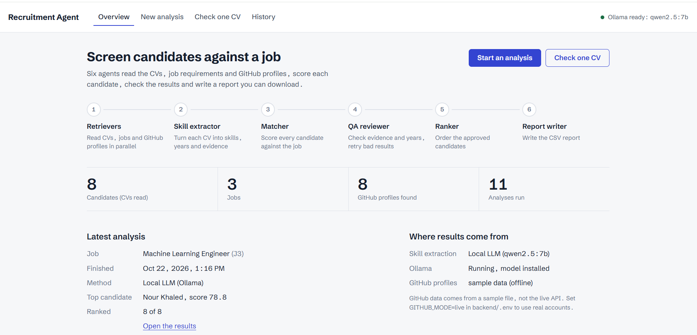
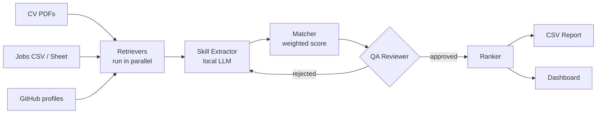
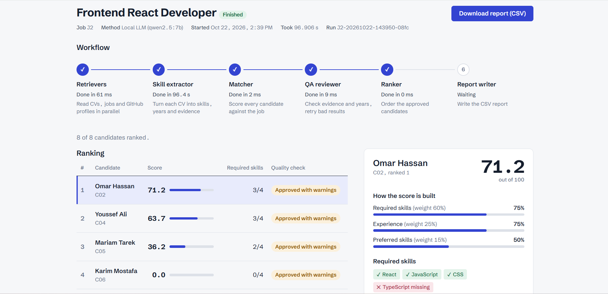
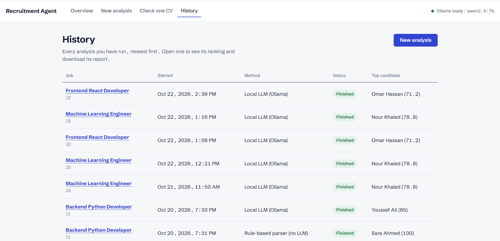
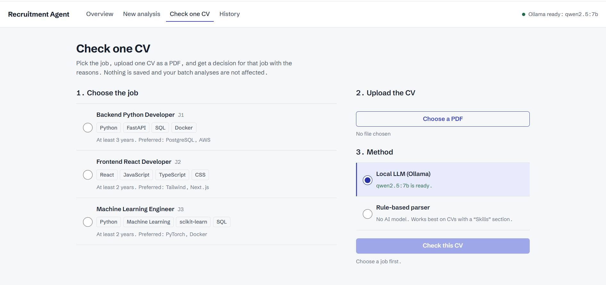

# Recruitment Agent

A multi-agent system that screens CVs against a job. Specialised agents read the data, extract skills with a local LLM, score each candidate, verify the result and produce a ranked report. Everything runs locally and for free with [Ollama](https://ollama.com).



## How the agents work together



| Agent | Job |
|-------|-----|
| **Retrievers** | Read CVs, job requirements and GitHub activity in parallel. A broken file is reported and skipped, never fatal. |
| **Skill Extractor** | A local LLM (`qwen2.5:7b`) turns each CV into skills, years, education and an exact quote as evidence for every skill. Invalid JSON is sent back to the model for repair. |
| **Matcher** | Plain code, no LLM. `score = 100 × (0.60 × required + 0.25 × experience + 0.15 × preferred skills)`. |
| **QA Reviewer** | Checks every skill and quote against the CV text and rejects contradictions. A rejected result goes back to the extractor with feedback. |
| **Ranker & Reporter** | Orders the approved candidates, saves the run and writes a CSV identical to what the dashboard shows. |

The LLM is used only where free text must be understood. Scoring and QA are deterministic, so every number can be explained. One failing CV never stops the others.

## Features

**Analyse all CVs.** Pick a job, watch the pipeline run live, then review the ranking and each candidate's score breakdown, evidence and QA notes.



**History.** Every run is saved so you can reopen past rankings and download their reports.



**Check one CV.** Choose the job, upload a PDF and get a clear decision, **Suitable / Not suitable / Needs further review**, with matched and missing skills, relevant experience, missing information and the score formula.



## Quick start

Requirements: Python 3.11+, Node 18+, [Ollama](https://ollama.com).

> The virtual environment (`.venv`) and `node_modules` are **not included** in the repository. Create the environment and install the dependencies yourself, as shown below.

```bash
# 1. model (free, ~5 GB)
ollama pull qwen2.5:7b

# 2. backend: create a virtual environment and install the requirements
cd backend
python -m venv .venv
source .venv/bin/activate                             # Windows: .venv\Scripts\activate
pip install -r requirements.txt
cp .env.example .env                                  # Windows: copy .env.example .env
python scripts/generate_sample_data.py                # fictional CVs and jobs
uvicorn app.main:app --reload --port 8000

# 3. frontend (second terminal): install the packages, then start
cd frontend
npm install
npm run dev                                           # http://localhost:5173
```

API docs: http://localhost:8000/docs · Tests: `cd backend && python -m pytest`

## Project structure

```text
backend/app/
  main.py          FastAPI endpoints
  runs.py          background runs + live stage status
  orchestrator/    workflow.py (the pipeline), pipeline.py, candidates.py, store.py
  retrievers/      cv, jobs, github
  agents/          extractor.py, matcher.py, qa.py
  decision.py      verdict for a single CV
  llm.py           the only module that talks to Ollama
backend/evaluation/  metrics and evaluation runner
frontend/src/        React + Vite dashboard
docs/                evaluation report, limitations
```

## Notes

- The CVs and jobs in `backend/data/` are fictional sample data, and results on them do not generalise to real hiring.
- The Matching Score measures overlap with the job's listed requirements. It is not the probability that a candidate is accepted, and it should support, not replace, a human decision.
- Evaluation results and known limits: [`docs/EVALUATION_REPORT.md`](docs/EVALUATION_REPORT.md), [`docs/LIMITATIONS.md`](docs/LIMITATIONS.md).